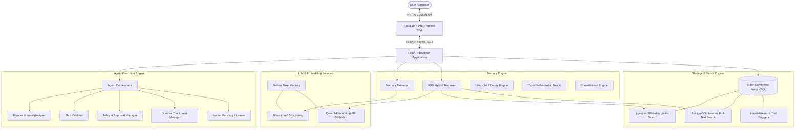

# MEMORA AI — System Architecture Specification

## 1. Executive Overview

**MEMORA AI** is an enterprise-grade personal AI memory and proactive agent intelligence platform. It couples a self-evolving long-term memory engine with a resilient, DAG-based multi-step agent execution system, all accessible through an interactive 8-workspace single-page application.

---

## 2. Frontend Workspace Architecture

The frontend is built using **React 19** and **Vite 8**, implementing an interactive multi-workspace interface:

| Workspace | Purpose | Key Components |
|---|---|---|
| **Chat Workspace** | Real-time conversational interface with memory grounding & live extraction preview | `ChatArea.jsx`, `MessageItem.jsx` |
| **Memory Explorer** | Browse, filter, search, inspect, and manually manage persistent memory records | `MemoryExplorer.jsx`, `MemoryCard.jsx` |
| **Agent Workspace** | Autonomous multi-step goal execution, DAG visualization, approvals, step tracking | `AgentWorkspaceView.jsx`, `TaskTimeline.jsx` |
| **Intelligence Graph** | Interactive node-link visualization of typed memory relationships (`SUPPORTS`, etc.) | `IntelligenceGraph.jsx` |
| **Notes Workspace** | Long-form persistent markdown notes created manually or autonomously by agent tasks | `NotesView.jsx`, `NoteEditor.jsx` |
| **Lifecycle View** | Real-time decay scoring, access frequency, confidence levels, and evolution tracking | `LifecycleView.jsx` |
| **Consolidation** | Clustering episodic memories into stable, high-level semantic profiles and reflections | `ConsolidationView.jsx` |
| **System Dashboard** | Cluster statistics, database health, token usage metrics, and audit log inspector | `DashboardView.jsx` |

---

## 3. Memory Subsystem Architecture

### 3.1 Vector & Text Representations
- **Vector Dimension**: `1024` dimensions (`vector(1024)` in Neon PostgreSQL).
- **Embedding Model**: `Qwen/Qwen3-Embedding-8B` hosted on Nebius TokenFactory API.
- **Full-Text Search**: PostgreSQL `tsvector` generated on memory content using `'english'` dictionary.

### 3.2 Hybrid Retrieval Engine (Reciprocal Rank Fusion)
Retrieval does not rely purely on vector similarity. It fuses semantic and keyword results using Reciprocal Rank Fusion (RRF):

$$RRF\_Score(d) = \frac{W_{semantic}}{k + Rank_{vector}(d)} + \frac{W_{keyword}}{k + Rank_{keyword}(d)}$$

- Default constant $k = 60$.
- Configurable weights: $W_{semantic} = 0.50$, $W_{keyword} = 0.50$.
- Similarity threshold cutoff: $0.58$ cosine distance.

### 3.3 Memory Lifecycle & Evolution
1. **Decay Scoring**: Confidence scores undergo exponential half-life decay based on elapsed time without recall.
2. **Access Reinforcement**: Every time a memory is recalled during chat or agent execution, its confidence and importance scores are boosted.
3. **Contradiction Detection**: Semantic conflict analysis detects when new user inputs contradict previous facts (e.g., changing favorite language), updating older memories to inactive and creating superseding links.
4. **Typed Relationship Graph**: Memories are linked as nodes in `memory_relationships` with typed edges: `SUPPORTS`, `CONTRADICTS`, `EXTENDS`, and `RELATION`.

---

## 4. Agent Execution Subsystem

### 4.1 Plan Generation & Validation
- **Planner**: Natural language objectives are decomposed into structured `AgentPlan` objects containing step IDs, tool names, JSON arguments, and explicit prerequisite step dependencies (`dependencies: ["step_1"]`).
- **Plan Validator**: Rejects circular dependencies, unknown tool names, out-of-order execution steps, and invalid parameter structures before any action executes.

### 4.2 Wave-Based Concurrent DAG Execution
Independent steps execute concurrently in parallel waves:
1. Steps with zero unsatisfied dependencies are grouped into Wave 0.
2. Wave 0 steps execute concurrently via `asyncio.gather`.
3. Results are saved into the execution state context.
4. Dependent steps in subsequent waves are unlocked and executed until all steps reach a terminal state.

### 4.3 Human-in-the-Loop Approval Security
Certain high-impact tools (e.g., `create_note`, external mutations) require explicit human approval:
- The task halts in `AWAITING_APPROVAL` status.
- An HMAC-SHA256 cryptographic approval token is issued to the client.
- Resumption requires submitting the exact token and step ID.
- Tokens are one-time-use; replay attempts are rejected.

### 4.4 Worker Fencing & Crash Resilience
- **Worker Leases**: Executing workers hold a leased lock (`worker_id`, `lease_expires_at`) in PostgreSQL.
- **Heartbeat Verification**: Workers must renew leases every `WORKER_LEASE_MINUTES`.
- **Fencing Protection**: If a worker crashes or stalls, competing workers detect expired leases, preempt the stale worker, and resume execution from the last durable checkpoint.
- **Immutable Audit Trail**: All step transitions are recorded in `agent_execution_logs`. PostgreSQL triggers block raw `UPDATE` or `DELETE` operations on audit tables.

---

## 5. Technology Stack Summary

| Layer | Component | Version / Provider |
|---|---|---|
| **Frontend Framework** | React | 19.0.0 |
| **Frontend Tooling** | Vite | 6.2.0 |
| **Backend Framework** | FastAPI | 0.115.11 |
| **ASGI Server** | Uvicorn / Standard | 0.34.0 |
| **Database** | Neon PostgreSQL | PostgreSQL 16+ Serverless |
| **Vector Extension** | pgvector | 0.5.1+ (`vector(1024)`) |
| **Database Driver** | asyncpg / psycopg | 0.30.0 / 3.2.5 |
| **LLM Inference** | Nebius TokenFactory | `nvidia/Nemotron-3_5-Lightning` |
| **Embeddings** | Nebius TokenFactory | `Qwen/Qwen3-Embedding-8B` |
| **Linter** | Oxlint | 0.15.10 |
