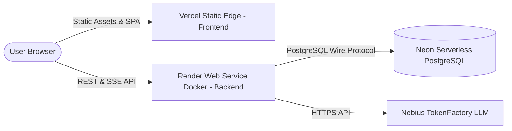

# MEMORA AI — Deployment & Infrastructure Guide

## 1. Production Architecture Overview

MEMORA AI utilizes a decoupled, modern two-tier deployment architecture:



- **Frontend**: Hosted on **Vercel** as a high-performance static Single Page Application (SPA).
- **Backend**: Hosted on **Render** as a long-running, persistent Docker Web Service.
- **Database & Vectors**: Hosted on **Neon Serverless PostgreSQL** with `pgvector` (`vector(1024)`).
- **Inference**: Hosted on **Nebius TokenFactory** (`Nemotron-3_5-Lightning` and `Qwen3-Embedding-8B`).

---

## 2. Platform Evaluation & Hosting Assessment

### 2.1 Frontend on Vercel: PASS (Recommended)
- **Status**: Production-ready.
- **Mechanism**: Pre-compiled React 19 + Vite 8 static bundle.
- **Routing**: `frontend/vercel.json` provides an explicit catch-all rewrite rule (`/(.*)` → `/index.html`) to support client-side SPA routing across all 8 workspaces.
- **Asset Caching**: Vite generates hashed asset filenames (`/assets/*.js`, `/assets/*.css`), allowing aggressive immutable CDN caching on Vercel's global edge network.

### 2.2 Backend on Vercel Serverless: NOT RECOMMENDED (Incompatible with Agent Workloads)
Deploying the FastAPI backend to Vercel Serverless Python functions is strongly discouraged for the following technical reasons:

1. **Function Execution Timeouts**:
   - Vercel serverless functions enforce strict execution limits (10s on Hobby tier, 15s to 300s on Pro).
   - Multi-step agent DAG execution (involving planning, multiple LLM tool invocations, and reflection) routinely exceeds 10–30 seconds.
2. **Immediate Execution Freeze**:
   - Vercel freezes execution context immediately upon delivering an HTTP response.
   - Background tasks, heartbeat worker leases (`WORKER_LEASE_MINUTES`), and async maintenance loops cannot run.
3. **Worker Leasing & Fencing Failure**:
   - The agent architecture relies on active worker heartbeats in PostgreSQL to prevent duplicate execution. Serverless cold starts and context suspension cause spurious lease expirations and split-brain execution states.
4. **Database Connection Pool Exhaustion**:
   - Serverless invocations spawn isolated processes, preventing persistent `asyncpg` connection pooling and overwhelming database connection limits.

### 2.3 Backend on Render Web Service: PASS (Recommended)
- **Status**: Production-ready.
- **Mechanism**: Containerized via `backend/Dockerfile` with a persistent Uvicorn ASGI server.
- **Features**: Persistent connection pooling, uninterrupted agent DAG execution, reliable background lease renewal, and continuous health check monitoring.

---

## 3. Deployment Configuration

### 3.1 Render Blueprint (`render.yaml`)

The repository root includes a validated Render Blueprint (`render.yaml`).

```yaml
services:
  - type: web
    name: memora-ai-backend
    runtime: docker
    dockerfilePath: backend/Dockerfile
    plan: free
    region: oregon
    healthCheckPath: /health
    autoDeploy: true
    envVars:
      - key: ENVIRONMENT
        value: production
      - key: DATABASE_URL
        sync: false
      - key: NEBIUS_API_KEY
        sync: false
      - key: NEBIUS_BASE_URL
        value: https://api.tokenfactory.nebius.com/v1
      - key: NEBIUS_MODEL
        value: nvidia/Nemotron-3_5-Lightning
      - key: NEBIUS_EMBEDDING_MODEL
        value: Qwen/Qwen3-Embedding-8B
      - key: EMBEDDING_DIMENSION
        value: 1024
      - key: EMBEDDING_DIM
        value: 1024
      - key: FRONTEND_ORIGIN
        sync: false
      - key: AUTH_SECRET_KEY
        generateValue: true
```

> [!IMPORTANT]
> **Embedding Dimension Alignment**: The Neon PostgreSQL column `memories.embedding` is strictly `vector(1024)`. Ensure `EMBEDDING_DIMENSION: 1024` and `EMBEDDING_DIM: 1024` are configured. Never use `4096`.

### 3.2 Frontend Vercel Configuration (`frontend/vercel.json`)

```json
{
  "buildCommand": "npm run build",
  "outputDirectory": "dist",
  "rewrites": [
    {
      "source": "/(.*)",
      "destination": "/index.html"
    }
  ]
}
```

---

## 4. Step-by-Step Deployment Guide

### Step 1: Deploy Backend to Render
1. Connect your GitHub repository to [Render](https://render.com).
2. Create a new **Blueprint Instance** pointing to `render.yaml`, or create a **Web Service** using `backend/Dockerfile`.
3. Fill in secret environment variables in the Render Dashboard:
   - `DATABASE_URL`: Your pooled Neon connection string (`postgresql://...@ep-pooler...neon.tech/neondb?sslmode=require`).
   - `NEBIUS_API_KEY`: Your Nebius TokenFactory API key.
   - `FRONTEND_ORIGIN`: Your production Vercel frontend URL (e.g., `https://memora-ai.vercel.app`).
   - `AUTH_SECRET_KEY`: A random 32-character hex or UUID string.
4. Click **Deploy**. Verify the service reports healthy at `https://<your-backend>.onrender.com/health`.

### Step 2: Deploy Frontend to Vercel
1. Connect your GitHub repository to [Vercel](https://vercel.com).
2. Set the **Root Directory** to `frontend`.
3. In Project Settings > Environment Variables, configure:
   - `VITE_API_BASE_URL`: `https://<your-backend>.onrender.com` (do not add a trailing slash).
4. Click **Deploy**.

---

## 5. Post-Deployment Verification Checklist

- [ ] `GET https://<backend>/health` returns `{"status": "healthy", "database": "connected"}`.
- [ ] `GET https://<backend>/api/system/info` returns sanitized environment status without leaking secrets.
- [ ] Send a message in the Chat Workspace and verify memory persistence in the Memory Explorer.
- [ ] Create an agent goal in the Agent Workspace and verify step execution and approval gates.
- [ ] Inspect browser console to confirm zero CORS errors between Vercel and Render.
